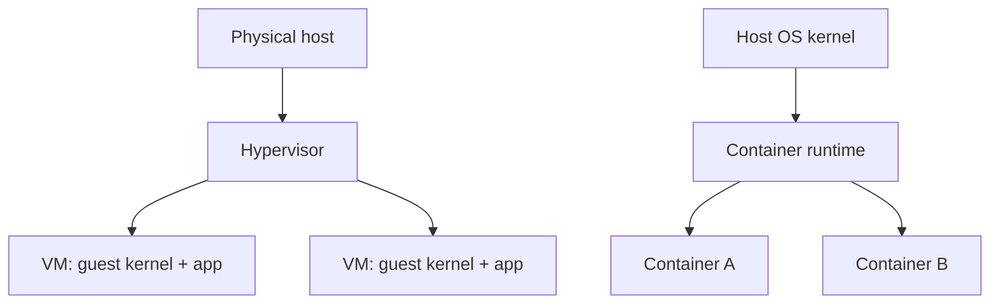

# Containers vs Virtual Machines

## Introduction
Virtual machines virtualize hardware and usually run a guest OS kernel. Containers isolate application processes while sharing the host kernel.

## Definition
A VM is a virtualized machine with virtual hardware and a guest OS. A container is an isolated process environment assembled using operating-system features and a container image.

## How It Works
A VM hypervisor provides virtual CPU, memory, disk, and networking to a guest OS. A container runtime uses an image plus kernel features such as namespaces and control groups to run isolated processes.

## Important Components
- **Image:** Read-only template used to create containers.
- **Container runtime:** Starts and manages containers.
- **Namespace:** Separates views of selected system resources.
- **cgroups:** Account for and limit resource use.
- **Hypervisor:** Runs virtual machines.

## Real-World Example
A CI pipeline may build a Docker image, test it, and deploy containers to a cluster. VMs may provide the underlying nodes where those containers run.

## Why DevOps Engineers Need This
Containers help make builds and deployments repeatable. VMs and containers solve related but different isolation and packaging problems.

## Diagram


## Linux Commands and Examples
### `docker version`
Show Docker client/server versions if installed.

```bash
docker version
```

### `docker ps`
List running containers if Docker is available.

```bash
docker ps
```

### `systemd-detect-virt`
Inspect virtualization hints.

```bash
systemd-detect-virt
```

Some commands may not be installed in a minimal environment. Output and available options vary by distribution and machine.

## Troubleshooting Scenarios
If a container fails, inspect its logs, image, environment, ports, mounts, and resource limits. If the container engine is unavailable, verify installation and service state rather than assuming the application itself is broken.

## Hands-On Lab
If Docker is already installed, run `docker version` and `docker ps`. Do not install software or run privileged containers solely for this lab. Explain which parts are supplied by an image and which are provided by the host.

## Interview Questions and Answers
### 1. Do containers normally have their own kernel?
No; they share the host kernel.

### 2. What does a container image contain?
Application files and dependencies plus metadata needed to create a container.

### 3. What does a hypervisor manage?
Virtual machines and their virtualized hardware resources.

### 4. What do cgroups help manage?
Resource accounting and limits for groups of processes.

### 5. Can containers run inside VMs?
Yes; a VM often provides the host OS for containers.

## Practice Assignment
Compare VMs and containers for a CI runner, a database, and a stateless web service. Explain the trade-offs and do not assume one option is always best.

## Key Takeaways
- Virtual machines virtualize hardware and usually run a guest OS kernel. Containers isolate application processes while sharing the host kernel.
- Understand the components and how to inspect them safely.
- Gather evidence before making changes.
- Connect this concept to production reliability and security.

## Further Learning
Docker images, namespaces, cgroups, Kubernetes, container security.
