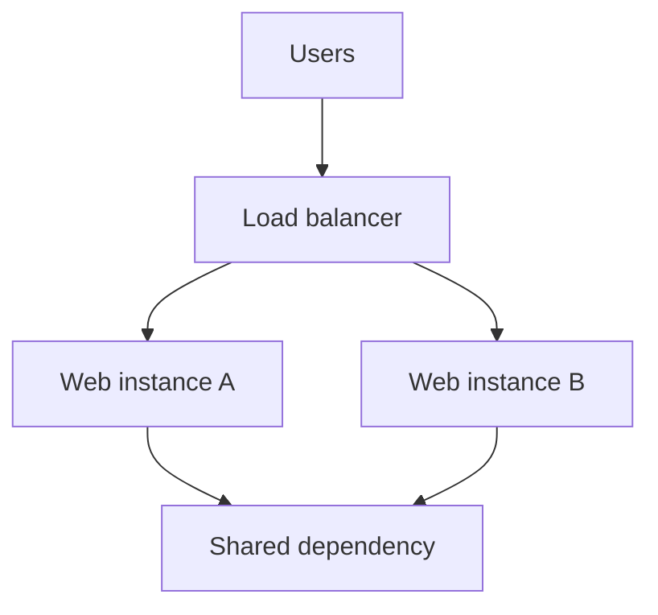

# Load Balancing and High Availability

## Introduction
A load balancer distributes requests across backend targets. High availability aims to keep a service usable when individual components fail.

## Definition
Load balancing distributes traffic among multiple targets according to a policy. High availability is an architecture and operating goal focused on reducing service downtime.

## How It Works
A client sends traffic to a load balancer. The load balancer selects a healthy backend and forwards the request. Health checks detect some failures, while redundancy and recovery procedures help keep the overall service available.

## Important Components
- **Listener:** Accepts traffic on a protocol and port.
- **Target/backend:** Instance or service receiving forwarded traffic.
- **Health check:** Determines whether a target should receive traffic.
- **Redundancy:** Multiple components or paths reduce single points of failure.
- **Failover:** Moves service to a healthy alternative.

## Real-World Example
Two web instances in separate Availability Zones can serve traffic through a load balancer. A single database or a single-zone dependency may still remain a failure point.

## Why DevOps Engineers Need This
Production deployments need health checks, scaling, resilient architecture, monitoring, and tested recovery—not simply more instances.

## Diagram


## Linux Commands and Examples
### `curl -I https://example.com`
Test an HTTP endpoint.

```bash
curl -I https://example.com
```

### `ss -tuln`
Check local listening ports.

```bash
ss -tuln
```

### `systemctl status <service>`
Inspect a service; replace the placeholder with a real unit name.

```bash
systemctl status <service>
```

Some commands may not be installed in a minimal environment. Output and available options vary by distribution and machine.

## Troubleshooting Scenarios
If requests fail, inspect load-balancer listener and target health, backend service state, firewall rules, application logs, and shared dependencies. A passing TCP check does not always prove the application can serve valid requests.

## Hands-On Lab
Draw a load balancer with two backends and mark what happens when one backend becomes unhealthy. Identify at least two possible single points of failure.

## Interview Questions and Answers
### 1. What is load balancing?
Distributing requests across backend targets.

### 2. What is a health check?
A test used to determine whether a target is eligible to receive traffic.

### 3. Does adding instances guarantee HA?
No; shared dependencies or a single-zone design can still fail.

### 4. What is failover?
Switching service to a healthy alternative after a failure.

### 5. Why monitor backend health?
To detect failures and prevent routing traffic to unhealthy targets.

## Practice Assignment
Design a highly available web tier across two Availability Zones. Include health checks, monitoring, and one test that demonstrates backend failover.

## Key Takeaways
- A load balancer distributes requests across backend targets. High availability aims to keep a service usable when individual components fail.
- Understand the components and how to inspect them safely.
- Gather evidence before making changes.
- Connect this concept to production reliability and security.

## Further Learning
Cloud load balancers, autoscaling, monitoring, disaster recovery.
