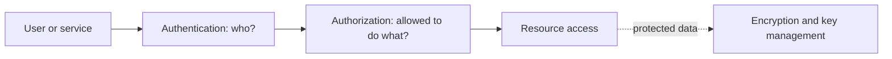

# Authentication, Authorization, and Encryption

## Introduction
Authentication verifies identity, authorization determines allowed actions, and encryption protects data from being read without the appropriate key.

## Definition
Authentication is identity verification. Authorization is access control. Encryption transforms data using cryptographic algorithms and keys so it is not readable without decryption.

## How It Works
A user or service proves identity using an approved method. A policy then determines permitted actions. Data may be encrypted in transit with TLS or at rest with storage/database encryption, with keys managed separately.

## Important Components
- **Identity:** A user, workload, or service account.
- **Authentication factor:** Something known, possessed, or inherent, depending on the method.
- **Authorization policy:** Rules describing permitted actions.
- **TLS:** Protects data in transit.
- **Key management:** Controls creation, storage, rotation, and access to cryptographic keys.

## Real-World Example
A CI runner authenticates to a cloud identity service, receives limited permissions to deploy one application, and obtains secrets through an approved secret manager.

## Why DevOps Engineers Need This
Least privilege, secrets management, audit trails, secure connections, and key rotation reduce the impact of compromised accounts and misconfiguration.

## Diagram


## Linux Commands and Examples
### `id`
Show current Linux identity and group membership.

```bash
id
```

### `ssh -V`
Show SSH client version.

```bash
ssh -V
```

### `openssl version`
Show OpenSSL version if installed.

```bash
openssl version
```

### `git status --short`
Review repository changes before committing; it does not detect every secret.

```bash
git status --short
```

Some commands may not be installed in a minimal environment. Output and available options vary by distribution and machine.

## Troubleshooting Scenarios
If access is denied, check identity, role/policy, resource scope, and audit logs. If a secret is exposed, revoke or rotate it promptly; deleting it from the latest file alone may not remove it from history or logs.

## Hands-On Lab
Create a checklist for a CI pipeline: identity used, permissions required, where secrets are stored, how TLS is verified, and how access is audited. Do not use real credentials in the exercise.

## Interview Questions and Answers
### 1. What question does authentication answer?
Who are you?

### 2. What question does authorization answer?
What are you allowed to do?

### 3. What is encryption at rest?
Protection of stored data using encryption.

### 4. What does TLS protect?
Data in transit and, when validated correctly, server identity.

### 5. What should happen after a secret leaks?
Revoke or rotate it, investigate exposure, and update affected systems.

## Practice Assignment
Design least-privilege access for a deployment pipeline that updates one service but must not delete unrelated cloud resources.

## Key Takeaways
- Authentication verifies identity, authorization determines allowed actions, and encryption protects data from being read without the appropriate key.
- Understand the components and how to inspect them safely.
- Gather evidence before making changes.
- Connect this concept to production reliability and security.

## Further Learning
Linux permissions, IAM, SSH, TLS certificates, secrets managers.
