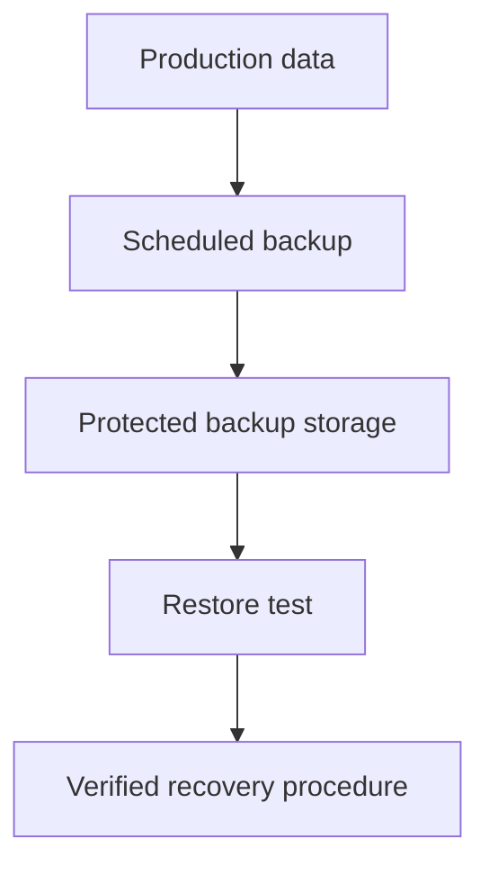

# Backup and Disaster Recovery

## Introduction
Backups provide recoverable copies of data. Disaster recovery (DR) describes how systems and data are restored after serious disruption.

## Definition
A backup is a copy retained for recovery. DR is the people, procedures, and technology used to restore services after an outage or disaster.

## How It Works
Identify critical data and dependencies, define recovery objectives, create protected backups, monitor backup jobs, and regularly test restoration. Recovery may also require infrastructure recreation, DNS changes, and application validation.

## Important Components
- **RPO:** Recovery Point Objective: acceptable data-loss window measured in time.
- **RTO:** Recovery Time Objective: target time to restore service.
- **Retention:** How long backups are kept.
- **Restore test:** Verifies that a backup can actually be recovered.
- **Offsite/isolated copy:** Reduces the risk that one incident destroys both production data and backups.

## Real-World Example
A website recovery plan may require database backups, uploaded media, configuration, deployment artifacts, and a tested way to rebuild servers.

## Why DevOps Engineers Need This
Infrastructure as Code can rebuild infrastructure but does not automatically back up business data or prove that restoration works.

## Diagram


## Linux Commands and Examples
### `df -h`
Check filesystem capacity before backup tasks.

```bash
df -h
```

### `tar -tf archive.tar`
List archive contents without extracting; use only with a known archive.

```bash
tar -tf archive.tar
```

### `sha256sum file`
Calculate a checksum to help verify file integrity.

```bash
sha256sum file
```

Some commands may not be installed in a minimal environment. Output and available options vary by distribution and machine.

## Troubleshooting Scenarios
A successful backup job does not guarantee a successful restore. Verify logs, backup age, retention, permissions, encryption keys, and restore procedures in a non-production environment.

## Hands-On Lab
Define an RPO and RTO for a sample website. List the data and configuration needed for recovery, and design a safe restore test using sample files.

## Interview Questions and Answers
### 1. What is a backup?
A copy of data or configuration retained for recovery.

### 2. What does RPO measure?
The acceptable data-loss window measured in time.

### 3. What does RTO measure?
The target time to restore service.

### 4. Why test restores?
To confirm the backup is usable and recovery steps work.

### 5. Does Infrastructure as Code replace data backups?
No; it can recreate infrastructure but does not by itself preserve application data.

## Practice Assignment
Write a disaster-recovery runbook with roles, backup validation, restore steps, application checks, and communication responsibilities.

## Key Takeaways
- Backups provide recoverable copies of data. Disaster recovery (DR) describes how systems and data are restored after serious disruption.
- Understand the components and how to inspect them safely.
- Gather evidence before making changes.
- Connect this concept to production reliability and security.

## Further Learning
Monitoring, cloud snapshots, database recovery, incident response.
