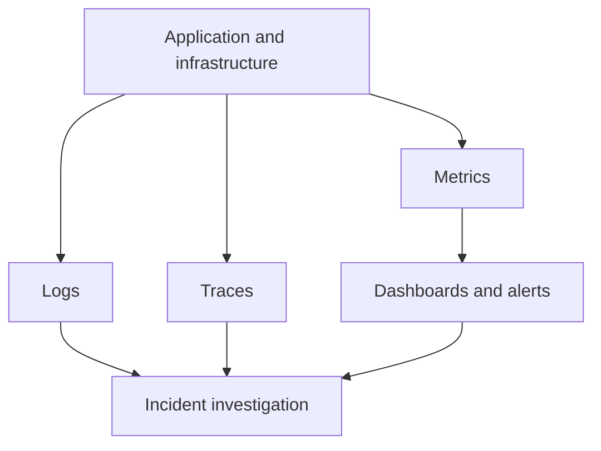

# Monitoring, Logging, and Troubleshooting

## Introduction
Monitoring measures system behavior, logs record events, and troubleshooting uses evidence to identify and resolve a problem.

## Definition
Monitoring collects metrics and evaluates system state. Logging records events. Troubleshooting is a structured process for narrowing down causes and verifying a fix.

## How It Works
Define service health indicators, collect metrics and logs, alert on actionable conditions, investigate incidents by layer, test one hypothesis at a time, apply a safe fix, and verify recovery.

## Important Components
- **Metrics:** Numeric measurements such as CPU, memory, latency, and error rate.
- **Logs:** Timestamped events from systems and applications.
- **Traces:** Show a request's path across services.
- **Alert:** Notification triggered by a defined condition.
- **Runbook:** Documented steps for responding to a known issue.

## Real-World Example
If a website is slow, correlate request latency with CPU, memory, disk I/O, network behavior, application logs, and database latency.

## Why DevOps Engineers Need This
Observability supports incident response, service-level objectives, capacity planning, deployment verification, and continuous improvement.

## Diagram


## Linux Commands and Examples
### `uptime`
Show uptime and load averages.

```bash
uptime
```

### `free -h`
Inspect memory.

```bash
free -h
```

### `df -h`
Inspect filesystem capacity.

```bash
df -h
```

### `systemctl --failed`
List failed systemd units.

```bash
systemctl --failed
```

### `journalctl -p err -b`
Show error-priority journal entries from the current boot.

```bash
journalctl -p err -b
```

### `ss -tuln`
Inspect listening sockets.

```bash
ss -tuln
```

Some commands may not be installed in a minimal environment. Output and available options vary by distribution and machine.

## Troubleshooting Scenarios
Start with the symptom and impact, check recent changes, identify the failing layer, gather evidence, test one hypothesis at a time, apply the smallest safe fix, verify recovery, and document findings. Avoid restarting services before gathering basic evidence unless urgent mitigation is required.

## Hands-On Lab
Simulate an investigation on your own machine: record uptime, memory, disk usage, failed units, and listening ports. Create a short report that distinguishes observations from hypotheses.

## Interview Questions and Answers
### 1. What is a metric?
A numeric measurement of system or application behavior.

### 2. What are logs useful for?
Understanding events and context around a problem.

### 3. What is a trace?
A representation of a request's path across components.

### 4. Why check recent changes?
A deployment or configuration change may correlate with the start of a failure.

### 5. Why verify after a fix?
To confirm the symptom is resolved and no new problem was introduced.

## Practice Assignment
Write a troubleshooting checklist for an unavailable website. Include host resources, service state, ports, DNS, logs, recent changes, and final verification.

## Key Takeaways
- Monitoring measures system behavior, logs record events, and troubleshooting uses evidence to identify and resolve a problem.
- Understand the components and how to inspect them safely.
- Gather evidence before making changes.
- Connect this concept to production reliability and security.

## Further Learning
Prometheus, Grafana, centralized logging, tracing, SLOs, incident response.
